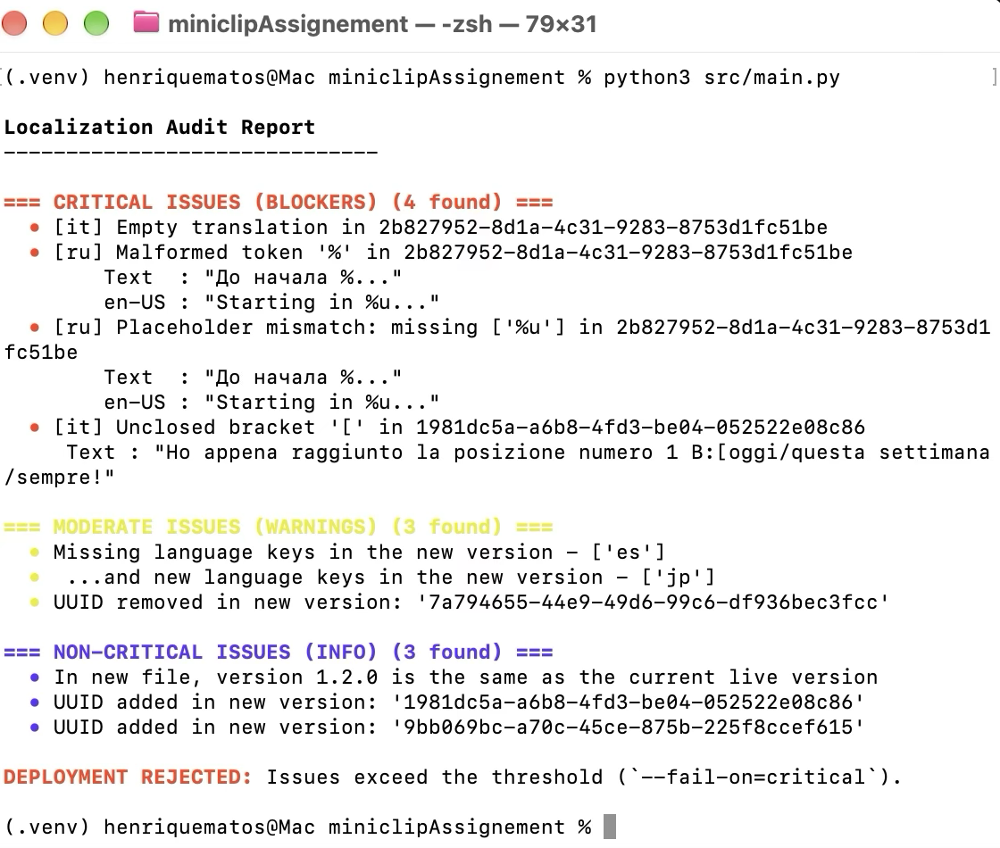
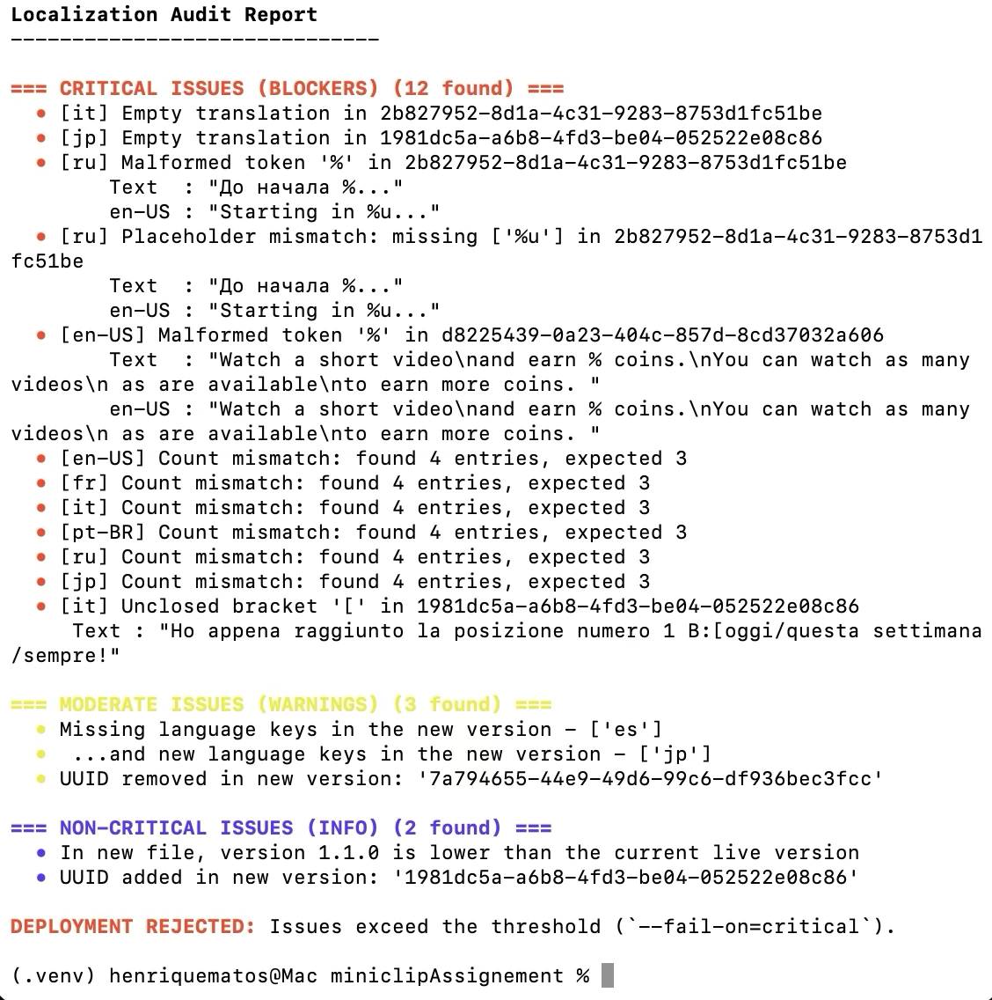

# Junior Tools Software Developer — Solution Henrique Matos

## Summary

CLI tool that checks deployment feasibility, according to .plist file changes, to be used in applications. Flags issues, according to fixing priority (CRITICAL - Heavy Priority; MODERATE - Mid Priority; NON-CRITICAL - Low Priority).

## Problems tackled and my rationale

It is desired for the tool to not be exhaustively detecting issues. The main scenario of having a developer checking critical issues in, maybe around 15 minutes, in order to have the app deployed had to be taken into consideration, therefore, three check-priorities made were conceived:
- Heavy Priority: critical issues that would break the app, rendering deployment completely unfeasible; alerted with (CRITICAL)
- Mid Priority: warnings where the developer is able to understand non-breaking app fixes are to be made; alerted with (MODERATE)
- Low Priority: information provided regarding metadata that is not in accordance to what is expected of it; alerted with (NON-CRITICAL)

Eight areas of operation were detected, ranging from heavy to low priority.
1. Checking if any variable placeholders are missing (heavy-priority)
    - (CRITICAL) if a placeholder variable is missing, game-breaking artifacts may occur, leaving the app incomplete (due to code not loading what it should have been loaded) and the user frustrated due to broken components
2. Checking if no string is left empty, so that no localisation is missing (heavy-priority) 
    - (CRITICAL) missing text would leave users confused, from a usability standpoint; if a string is missing and if the code is not completely protected, the game component could break, leaving said part of the app unusable
3. Checking if the number of UUID keys and the number of localisation keys match. If not, it means a localisation is missing entirely from a UUID (heavy-priority)
    - (CRITICAL) eg., UUID Total: 4; Localisation count 4 en-US, 4 it, 3 ru, 4 jp - the 3 ru means 1 is missing 
6. Checking if any rectangular bracket has been closed, if opened (heavy-priority)
    - (CRITICAL) this could trigger an exception where the application would detect an object to be missing 
4. Checking if any language keys have either changed or removed (mid-priority)
    - (MODERATE) if a language has either been removed or a new one has been added (or even both at the same time), that could have been developer intent. Nevertheless, it was considered mid-priority due to assumptions made, as to be explained further in the document; could be deployed, assuming intent
5. Checking if any UUID keys have been removed (mid-priority):
    - (MODERATE) removing UUID keys could be intentional, due to the phasing-out of a component. However, despite developer intent, a warning is to be triggered in order to alert and have the developer be sure intentions were met
7. Checking if the new .plist version is different, and higher (because a developer could've mistyped it to be lower) (low-priority)
    - (NON-CRITICAL) alerts regarding metadata is not a priority to fix since it is assumed it does not directly intertwine with the game components
8. Checking if any UUID keys have been added (low-priority);
    - (NON-CRITICAL) if a new set of localisations is added, a new UUID will be consequently added


<b>I've created a .plist file ("docs/broken_localisations_1_2_1.plist"), based on the original 1.2.1, broken even further so that more detections are flagged, for demonstration purposes.</b>

## Assumptions made and Trade-offs

- English (en-US, in the .plist files) is set to be the reference for the absolute truth in each string. If there are no placeholders in the en-US version, it is assumed there will be no need for placeholders anywhere. I declare this as being risky in some hypothetical operations. However, it serves as the reference for all strings in the project.
    - If English is to be missing the placeholder symbols but, for ex., French and Italian have them but not Russian and Japanese, a suggestion could be having the algorithm adjusted to check if there is an average of placeholders set in place, warning the developer in the mid-priority checks; it's a matter of planning 

- No string is to be left empty. If localisation UUID keys exist, there <i>will</i> be text to be translated.

- The percentage symbol "%" is to be written in "%%" in a .plist file. If it appears with a lone "%", then it is assumed to be a misplaced placeholder.

- UUIDs may come and go if the application decides to get rid of a block of text (eg., a Halloween event is over); it is assumed that removing it can be intentional, nevertheless, it must be warned in the console, in case it was misdeleted by the developer 
    - it is assumed it should not impede deployment, since it may have been intentional; however, I do know that if a game component were to be linked to said UUID and it missed, something could break. I assumed the latter was not to happen, hence it being mid-priority (MODERATE) to the developer
    - a new UUID added is assumed to be intentional by the developer (eg., new event tomorrow), being kept as low-priority on the console through the tag (NON-CRITICAL) 

- Languages missing could be a deliberate choice from the developer (eg., the app is pulled from a certain country); I did not assume it could be game breaking, <i>if intentional</i>, keeping it mid-priority and warning that an entire language is missing from all localisations
    - The (MODERATE) also contains the alert for a new language that was added. The algorithm checks if a language is missing, checking against the current (1.2.0) version, also detecting if a replacement has occurred (instead of a simple miss)

- The .plist version is usually different in newer versions. However, since it was noticed it was not different, I passed it into low-priority checks, since it is assumed to be simply metadata, not being parsed into anything application-critical. It is passed through the console as (NON-CRITICAL)

- For the rectangular brackets, it was assumed they were prompts to be used in UI components (eg., buttons that would fetch said text). Kept as (CRITICAL) due to assuming it would be application/game-breaking if said buttons could not fetch the text, effectively not allowing the rendering of the host component 

- If the original document is to be the source of truth, bugs in there can be assumed they are to be fixed in the new version. If, for example, 1.2.0 was missing a placeholder (as it currently is in the 'fr' key), 1.2.1 must not have it missing as well. 
    - therefore, a pre-existing break still being present in 1.2.1 is correctly flagged (eg., the program is not to alert the old version was missing the placeholders on the key 'fr'; if the new version is also missing it, then it alerts, checking against the English reference as well)

## Blind Spots 

There are some deliberate choices made, that could be fixed with more time and more information from meetings with other teams involved in the hypothetical application:
- No length-check is being made
    - the thresholds would have to be language dependent and in accordance to the design and translation teams; there are no directions to be taken, I cannot simply cut a whole string in half or pass it as erratic if I have no way to know where it operates (I cannot know here if it belongs to a button or a text box); if a sentence in English is 5 words but in German is 3 and the latter has words that are 3-time longer, I cannot simply run a word count; token counts could also hinder the program in this way
    - therefore, given my defense, this is a blind spot BUT a future improvement to be taken into consideration; flagging as game-breaking would not be a good practice, as I do not know if the component has a design-imposed 30 or 300 word-limit

- I assume missing "\n" are not missing placeholders. Formatted text would become plain, continuous, text, but it could be intentional. It is also not something that is game-breaking, since it is not a variable placeholder 

- If a language is changed from, let's say, 'jp' to 'ja', the tool flags it. It is not an issue per se, since it is being flagged already, but it could be an improvement to have it detect changes in localisation keys that keep the same language (maybe running some libraries that detect translation automatically, such as 'langdetect')

## Evolution (from the smallest version to the final) & Next Steps

- Initial small version: started in a Jupyter notebook ("prototype.ipynb") validating XPath queries with "lxml" and building the core "CRITICAL" checks (empty strings, missing per-UUID languages, and "%" placeholder regex validation).

- Added after: modularized the logic into three severity classes ("Heavy", "Mid", "Low"), added "en-US" baseline comparisons, bracket validation, ANSI color-coded CLI output, and "--fail-on" exit codes for CI/CD integration.

- With another day: add a check comparing numbers in translated strings against "en-US" (e.g., catching when "30 seconds" is mistranslated as "3 segundos" in `pt-BR`), and validate that all custom bracket tags (e.g., `A:[...]`) match across every language (possibly through python-enabled translation libraries); this was not done due to not assuming to be high-priority, although I do acknowledge an issue with timing is misleading to the user (it's more of a usability concern than a deployment constraint)

## Setup and Run

From the repo root:

```bash
python3 -m venv .venv
source .venv/bin/activate        # Windows: .venv\Scripts\activate
pip install -r requirements.txt
python3 src/main.py
```

### Options

```bash
python3 src/main.py --current docs/localisations_1_2_0.plist --new docs/localisations_1_2_1.plist
python3 src/main.py --fail-on moderate
```

`--fail-on` sets which severity makes the tool exit with an error:

| Value | Fails on |
|---|---|
| `critical` (default) | critical issues only |
| `moderate` | critical or moderate issues |
| `any` | any issue, including info |

### Exit codes

| Code | Meaning |
|---|---|
| 0 | Passed, or only issues below the `--fail-on` threshold |
| 1 | Rejected: issues at or above the threshold |
| 2 | Could not run (missing or malformed `.plist`) |

### Demo with a deliberately broken file

```bash
python3 src/main.py --new docs/broken_localisations_1_2_1.plist
```

## Samples

### Running the algorithm against the initial "localisations_1_2_1.plist"



### Running the algorithm against a broken, manipulated, "broken_localisations_1_2_1.plist" 

